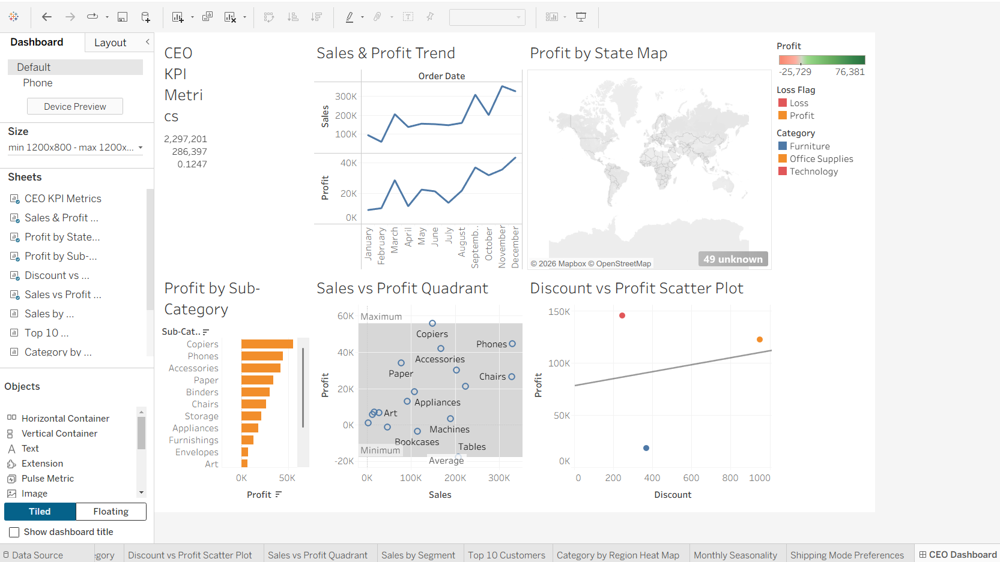
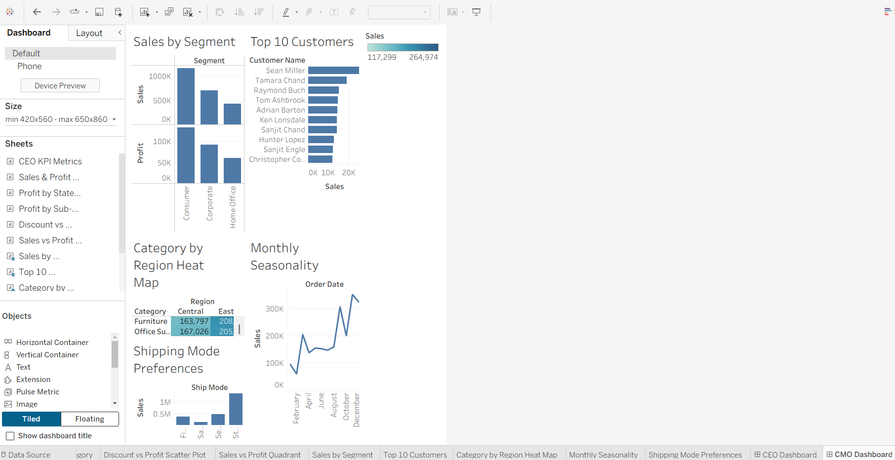

# Data Visualisation: Empowering Business with Effective Insights
**Tata Group (Tata iQ) Virtual Experience Program** | *Hosted via The Forage*

---

## 📌 Overview
Built Tableau dashboards for a CEO and a CMO to support data-driven decisions on profitability, discounting, customer value and campaign timing.

## 💼 Business Problem
Leadership needs to know what drives revenue and profit, where discounts hurt margins, which customers and regions matter most, and when to run marketing campaigns.

## 🛠️ Tools Used
Tableau Public, Excel, Python (Pandas), GitHub

## 📊 Dataset
Superstore Sales Dataset (Kaggle). Link: [Kaggle Sample Superstore Dataset](https://kaggle.com)

---

## 🚀 Approach
1. Framed the strategic questions the CEO and CMO would ask ([docs/task1_business_questions.md](docs/task1_business_questions.md))
2. Cleaned and explored the data using automated scripts ([notebooks/eda.py](notebooks/eda.py))
3. Chose the best visual layout for each executive query ([docs/task2_visual_choices.md](docs/task2_visual_choices.md))
4. Built interactive, synchronized dashboard systems in Tableau ([dashboards/](dashboards/))


---

## 🎛️ Dashboards

* **Live link:** [View My Dynamic Tableau Dashboards Profile](https://tableau.com)

### 👔 CEO Dashboard View


### 📢 CMO Dashboard View


---

## 🔍 Key Insights
* **Macro Financial KPIs:** Total sales reached **\$2,297,201** with a net profit of **\$286,397**, establishing an overall company margin of **12.5%**.
* **Regional Margin Vulnerability:** The **Central Region** is the absolute weakest on profit.
* **Promotional Discount Degradation Threshold:** Operating profit turns sharply negative the exact moment promotional discount structures exceed **20%**.
* **Systemic Inventory Drain:** The **Tables** sub-category represents our largest systemic cash leak, losing **-\$17,725** overall.
* **Chronological Peaks & Concentration:** Sales volume spikes dramatically in **November and December**, driven primarily by the **Consumer Segment**, which represents our largest single buying demographic.

---

## 💡 Recommendations
1. **Enforce a 20% Discount Ceiling:** Cap automated sales discounts at a maximum of 20% to instantly protect core transaction profitability.
2. **Restructure Underperforming Categories:** Review and optimize inventory pricing and vendor shipping margins for loss-making sub-categories like **Tables**.
3. **Align Campaign Budgets with Seasonality:** Start major multi-channel marketing initiatives in early October, targeting high-yield Consumer channels ahead of the November peak trading window.

---


---

## 📁 Repository Structure
```text
tata-iq-data-visualisation-project/
├── README.md                      <- Root Portfolio Index Documentation
├── data/
│   ├── superstore.csv             <- Raw Transaction Logs from Kaggle
│   └── cleaned_superstore.csv     <- Cleaned, Processed Target Rows Output
├── notebooks/
│   └── eda.py                     <- Python Pandas Automated Metric Engine
├── dashboards/
│   └── ceo_cmo_dashboards.twbx    <- Packaged Multidimensional Tableau Sheets
├── screenshots/
│   ├── ceo_dashboard.png          <- High-Resolution Visual Layout for the CEO
│   └── cmo_dashboard.png          <- High-Resolution Visual Layout for the CMO
└── docs/
    ├── task1_business_questions.md <- Strategic Inquiries Framework
    ├── task2_visual_choices.md     <- Chart Mapping Rationale Matrix
    └── task4_presentation_script.md<- Executive Video Presentation Script
```

---

## 👩‍💻 Author
**Dasari Pallavi** | [Connect on LinkedIn]
https://www.linkedin.com/in/dasari-pallavi/
